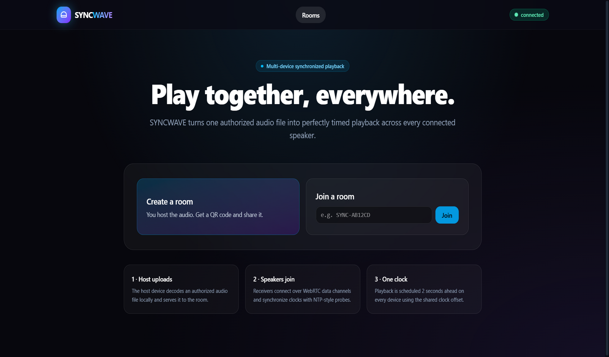

# SYNCWAVE



SYNCWAVE is a production-shaped web app that turns one **authorized** audio file into synchronized
playback across multiple devices. A host device serves the audio; receiver devices join by room code or
QR link, measure the clock offset to the host with NTP-style WebRTC probes, and schedule playback on a
shared timeline.

Spotify is supported as a **separate** integration. SYNCWAVE never captures, records, alters,
redistributes or retransmits Spotify audio, and Spotify playback is never mixed into the synchronized
audio engine.

## Stack

- React 18 + Vite 6 + TypeScript + Tailwind CSS 4 + Zustand
- Web Audio API (`AudioBufferSourceNode` scheduling), WebRTC data channels, Socket.IO signaling
- Node/Express/Socket.IO signaling server (`server/index.cjs`)
- Electron desktop shell (embeds the server and serves the built UI)
- Optional Spotify Web API (PKCE, metadata + transport controls only)

## Run locally

```bash
npm install
npm run server   # signaling + audio relay on http://localhost:8787
npm run dev      # Vite dev server on http://localhost:5173
```

Copy `.env.example` to `.env` when you need to override defaults.

- `VITE_SERVER_URL` — signaling server URL (defaults to `http://localhost:8787`).
- `VITE_TURN_URL` / `VITE_TURN_USERNAME` / `VITE_TURN_CREDENTIAL` — optional TURN relay for strict NATs.
- `VITE_SPOTIFY_CLIENT_ID` — optional; create a Spotify app whose redirect URI is the app origin.

### Testing on multiple devices

Using the desktop app:

1. Build once with `npm run build`, then launch with `npm run desktop`.
2. Host creates a room, uploads an authorized audio file, and shares the QR/join link. The link uses the
   host machine's LAN IP automatically, so phones on the same network can join.
3. Each receiver taps **Enable receiver audio** once (browser autoplay policy) before playback starts.

Using the web dev servers:

1. Start both processes on the host machine.
2. Run Vite with `npm run dev -- --host` and open the app through the host machine's LAN IP
   (e.g. `http://192.168.1.20:5173`).
3. Set `VITE_SERVER_URL` to `http://<LAN-IP>:8787` so phones can reach signaling.
4. Host creates a room, uploads an authorized audio file, and shares the QR/join link.
5. Each receiver taps **Enable receiver audio** once (browser autoplay policy) before playback starts.

## Desktop app (Electron)

The desktop build embeds the signaling/audio server in the Electron main process and serves the built UI
from it, so no separate server process is needed.

```bash
npm run build
npm run desktop
```

Desktop development with Vite hot reload (two terminals):

```bash
npm run dev          # terminal 1
npm run desktop:dev  # terminal 2
```

Package a Windows installer:

```bash
npm run dist         # NSIS installer in release/
```

The app binds to port 8787 when free (otherwise a random free port) and exposes it on the LAN so
receivers can join. The QR/join link resolves the host machine's LAN IPv4 address from `/api/network`.
Spotify OAuth redirects back to the embedded local origin; register `http://localhost:8787/` as the
redirect URI in the Spotify dashboard (restart the app if it had to pick a different port).

## How synchronization works

1. The host decodes the audio locally with Web Audio and uploads the file to the signaling server's
   in-memory room store; receivers fetch and decode the same bytes.
2. The host creates one `RTCPeerConnection` per receiver with an ordered data channel. Socket.IO is used
   only for signaling (offer/answer/ICE).
3. Every 2 seconds each peer sends a `sync_probe {t1}`; the other side replies with `{t3, echoT1}`.
   The estimator computes `offset = t3 - (t1 + t4) / 2` and `delay = (t4 - t1) / 2`, averaged over the
   last 24 samples with jitter as the standard deviation of one-way delay.
4. Playback commands carry an absolute host timestamp (`at = ctx.currentTime + lookahead + contextStart`).
   Receivers convert it to their own `AudioContext` timeline:
   `ctxTime = epochToCtx(at) - clockOffset - latencyOffset`.
5. Receivers report their current position once per second; the host displays measured drift and real
   RTT/jitter/packet-loss values from `RTCPeerConnection.getStats()`. No values are simulated.
6. Late joiners receive the current audio metadata and a scheduled catch-up command when their data
   channel opens.

## Host / receiver responsibilities

- **Host**: uploads audio, play/pause/stop/seek, starts the shared timeline, can adjust receiver volume,
  mute, latency compensation and disconnect speakers.
- **Receiver**: decodes the shared audio, schedules playback against the host clock, controls its own
  volume/mute and latency offset, and reports its playback position.

## Verification

```bash
npm run typecheck
npm run lint
npm run build
npm run server   # then, in another terminal:
npm run smoke
```

`npm run smoke` checks the health endpoint, audio upload/download, room creation/joining, signaling relay
and host-disconnect cleanup against a running server.

## Phased implementation plan (as built)

1. **Scaffold** — Vite/React/TypeScript/Tailwind/Zustand, dark studio UI shell, routing between home and room.
2. **Room lifecycle** — Socket.IO rooms, create/join/leave, room TTL, host-disconnect cleanup, QR/join links.
3. **WebRTC mesh** — per-peer connections, host-initiated offers, ICE trickle, ordered data channels, reconnection-safe event wiring.
4. **Clock sync** — NTP-style probes, offset/delay/jitter estimation, quality classification, live sync monitor.
5. **Audio pipeline** — local decode, server audio relay, scheduled playback with lookahead, seek/pause/stop, per-device gain.
6. **Speaker control** — per-speaker volume/mute/latency offset, disconnect, receiver position reporting and host drift display.
7. **Network diagnostics** — `getStats()` polling for RTT, jitter, packet loss and ICE candidate type.
8. **Spotify** — optional PKCE OAuth, currently-playing metadata, transport controls, strict separation from the sync engine.
9. **Hardening** — typecheck/lint/build, smoke tests, graceful error states, no simulated metrics or fake controls.

## Known limitations

- Audio is relayed through the signaling server's memory (max ~48 MB source file); this is a single-host
  deployment aid, not a CDN. Use authorized files only.
- Browsers require a user gesture on receiver devices before audio can play.
- Synchronization accuracy depends on network conditions; TURN is required for some NAT/firewall setups.
- Spotify playback requires Premium and an active Spotify device; the integration never touches the
  synchronized audio path.
- Supabase persistence is optional and not wired in this build; room signaling and audio relay are
  self-hosted by `server/index.cjs`. Add a persistence service layer behind the room lifecycle if durable
  metadata is required.
- The desktop app opens its embedded server to the local network so other devices can join; use it only on
  trusted networks.
